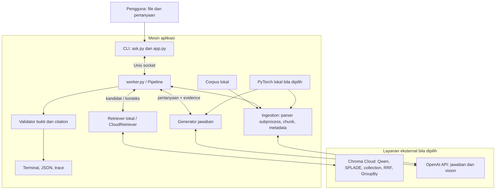
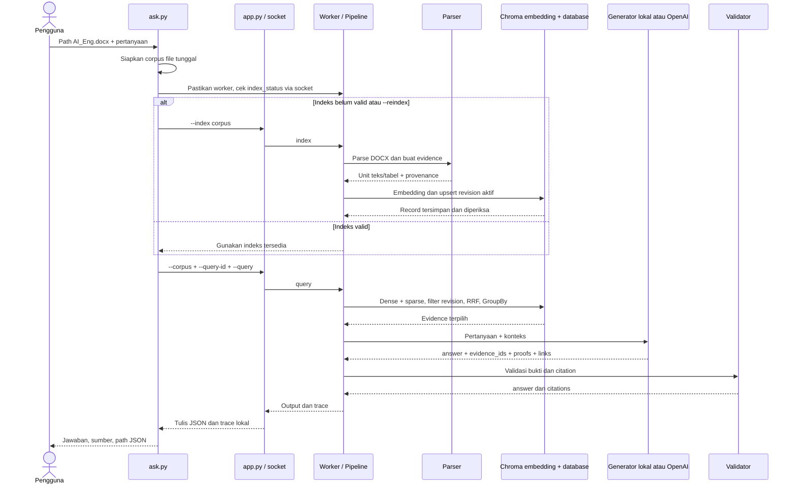

# RAG-Match3-AMD: Dokumentasi End-to-End

**Tanggal pemeriksaan:** 16 Oktober 2026, zona waktu Asia/Jakarta.  
**Repository:** <https://github.com/sanacvn/RAG-Match3-AMD>.  
**Dasar dokumentasi:** kode sumber, konfigurasi, dependency, README, dan pengujian yang dijalankan pada versi di bawah.

| Sumber yang diperiksa | Commit ringkas | Keterangan |
|---|---|---|
| Remote `main` | `115304c` | Acuan utama; sudah mencakup integrasi Chroma dan backend OpenAI. |
| Remote `feat/chroma-cloud` | `a0f3411` | Integrasi awal Chroma, migrasi, dan penggunaan ulang indeks. |
| Branch penulisan `docs/end-to-end` | Berbasis commit `115304c` | Menambahkan dokumen ini; tidak mengubah logika aplikasi. |

Commit lengkap `main`: `115304c0e03d7f6264c2ce861e34140f1a707ffe`.  
Commit lengkap fitur Chroma: `a0f3411bcdc2de1542242edd54b4eba7b9bb1077`.

**Perubahan penting antarversi:** pada branch Chroma awal, jawaban dan vision memakai model lokal. Pada `main` yang diperiksa, `.env.example` memilih OpenAI API untuk kedua fungsi tersebut. Mode PyTorch lokal tetap tersedia. Penjelasan berikut membedakan profil agar konfigurasi dari versi berbeda tidak tercampur. Contoh API key selalu berupa placeholder, bukan credential nyata.

## Daftar isi

1. [Ringkasan proyek](#ringkasan-proyek)
2. [Gambaran arsitektur](#gambaran-arsitektur)
3. [Proses dari sisi pengguna](#proses-dari-sisi-pengguna)
4. [Ingestion dan indexing di belakang layar](#ingestion-dan-indexing-di-belakang-layar)
5. [Dari pertanyaan menjadi jawaban](#dari-pertanyaan-menjadi-jawaban)
6. [Peran masing-masing model](#peran-masing-masing-model)
7. [Penyimpanan dan pengelolaan data](#penyimpanan-dan-pengelolaan-data)
8. [Konfigurasi dan instalasi](#konfigurasi-dan-instalasi)
9. [Lifecycle worker](#lifecycle-worker)
10. [Contoh penelusuran end-to-end](#contoh-penelusuran-end-to-end)
11. [Pengujian dan validasi](#pengujian-dan-validasi)
12. [Troubleshooting](#troubleshooting)
13. [Keterbatasan dan pengembangan berikutnya](#keterbatasan-dan-pengembangan-berikutnya)
14. [Glosarium](#glosarium)

# 1. Ringkasan proyek {#ringkasan-proyek}

RAG-Match3-AMD membantu pengguna mencari jawaban singkat dari kumpulan dokumen tanpa membuka setiap file secara manual. Sistem membaca dokumen, mencari potongan yang relevan, lalu menghasilkan jawaban yang dilengkapi sumber. Contohnya, pengguna memberikan dokumen rencana belajar dan bertanya, “Apa materi di bulan 1 hari ke 8?”

**RAG**, singkatan *Retrieval-Augmented Generation*, menggabungkan pencarian informasi dengan pembuatan jawaban oleh model bahasa. **Retrieval** memilih bukti dari dokumen; **generation** menghasilkan jawaban berdasarkan bukti tersebut. Proses ini tidak melatih ulang model pada dokumen pengguna.

Aplikasi memiliki antarmuka **CLI** (*Command-Line Interface*), yaitu perintah melalui terminal. Tidak ada antarmuka web untuk upload, halaman login, atau server HTTP lokal dalam implementasi yang diperiksa. `ask.py` menyederhanakan interaksi, sedangkan `app.py` menyediakan kontrak indexing dan query yang lebih eksplisit. [S01] [S02] [S03]

Ada dua pilihan terpisah: backend jawaban/vision dan backend pencarian. **Backend** adalah implementasi komponen yang menjalankan suatu fungsi.

| Profil | Jawaban dan vision | Pencarian/embedding | Kebutuhan utama |
|---|---|---|---|
| Cloud API, contoh konfigurasi `main` | OpenAI API | Chroma Cloud Qwen + SPLADE | Key OpenAI dan Chroma, Internet; tidak memuat bobot PyTorch lokal. |
| PyTorch lokal + Chroma | Transformers/PyTorch di mesin sendiri | Chroma Cloud Qwen + SPLADE | Bobot generator dan vision lokal, perangkat yang sesuai, key Chroma. |
| Lokal/offline | Transformers/PyTorch lokal | BM25 atau BGE/NumPy lokal, sesuai E0–E5 | Bobot sesuai metode; setelah provisioning, jalur inference dapat lokal. |
| Diagnostik CPU | Ekstraksi key/value literal, tanpa LLM | BM25 lokal | Dependency parsing; bukan pengganti model generatif atau uji kualitas AI. |

**LLM** (*Large Language Model*) adalah model bahasa yang menghasilkan jawaban. Dalam profil lokal, model ini dijalankan lewat PyTorch dan Transformers. Dalam profil OpenAI, model yang sama fungsinya diakses melalui **API**, antarmuka untuk memanggil layanan dari program. [S04] [S08] [S09]

Proyek juga memiliki target kompetisi AMD AI League Match 3. README mencatat batas startup, query, memori GPU, dan ukuran image. Dokumen resmi kompetisi tidak tersedia di checkout yang diperiksa, sehingga angka tersebut diperlakukan sebagai target yang dicatat repository, bukan hasil verifikasi panitia. Profil pengembangan Cloud tidak otomatis sesuai evaluator yang melarang jaringan. [S18]

# 2. Gambaran arsitektur {#gambaran-arsitektur}

## 2.1 Komponen dan lokasi eksekusi

**Worker** adalah proses Python yang tetap hidup untuk memegang model dan indeks. Program CLI mengirim permintaan melalui **Unix socket**, saluran komunikasi antarproses dalam mesin yang sama. Socket bukan endpoint web publik. [S03] [S16]



Alur pada diagram bersifat kondisional: profil lokal tidak memanggil OpenAI, dan mode offline tidak memanggil Chroma. **Corpus** berarti kumpulan dokumen yang boleh menjadi sumber jawaban; **evidence** adalah potongan isi corpus yang membawa identitas sumber. [S05] [S06]

| Komponen | Input | Proses utama | Output/lokasi |
|---|---|---|---|
| `ask.py` | Path dan pertanyaan | Validasi input, salin file tunggal, cek indeks, panggil klien | Jawaban terminal dan lokasi JSON, lokal. |
| `app.py` | Argumen indexing atau query | Kelola permintaan, deadline, dan file hasil | Pesan socket serta JSON/trace lokal. |
| `worker.py` | Pesan socket | Pilih operasi `ping`, `index_status`, `index`, atau `query` | Respons terstruktur, model/indeks tetap di memori. |
| Parser | File corpus | Baca isi dalam subprocess; siapkan tugas vision | Unit teks/tabel/gambar dan manifest. |
| Retriever | Evidence atau pertanyaan | Bangun indeks atau ambil kandidat relevan | Daftar evidence untuk generator. |
| Generator | Pertanyaan dan evidence terpilih | Hasilkan nilai jawaban dan bukti internal | JSON internal, lokal atau melalui API. |
| Validator | Hasil model dan evidence | Cek quote, ID, nilai, hubungan, dan path | `answer` serta `citations` yang lolos pemeriksaan. |

Rujukan implementasi: [S01]–[S10] dan [S16].

## 2.2 Kontrak jawaban

**Citation** adalah rujukan file yang mendukung jawaban. **JSON** (*JavaScript Object Notation*) adalah format data hasil yang dibaca aplikasi lain. Kontrak eksternal hanya berisi string `answer` dan list string `citations`:

```json
{"answer":"nilai dari dokumen","citations":["folder/sumber.txt"]}
```

Jawaban tidak dirancang sebagai esai bebas: validator menerima nilai satu baris maksimal 200 karakter yang harus muncul lengkap dalam kutipan evidence. Jika bukti tidak lolos pemeriksaan, hasilnya kosong. Ini penting saat pengguna meminta ringkasan panjang atau perhitungan baru; model yang bisa menulis prose belum tentu diperbolehkan validator untuk mengembalikannya. [S10] [S11]

# 3. Proses dari sisi pengguna {#proses-dari-sisi-pengguna}

## 3.1 Menyiapkan tempat kerja

Gunakan checkout repository yang sudah ada. Buat **virtual environment**, yaitu lingkungan Python terpisah untuk dependency aplikasi, lalu pilih salah satu profil pada bagian 8. Selesaikan instalasi dan konfigurasi sebelum meminta indexing.

File harus berada di mesin yang menjalankan Python. Contoh path Mac:

```text
/Users/aliaatikahsana/Desktop/AI_Eng.docx
```

Path itu hanya menunjuk file di Mac tersebut. Jika aplikasi berjalan di executor cloud, unggah atau salin file ke mesin itu, misalnya ke direktori corpus di workspace, kemudian gunakan path cloud:

```text
/workspace/corpus/AI_Eng.docx
```

Menuliskan path Mac pada mesin cloud tidak memindahkan file secara otomatis.

Gunakan folder dokumen yang terpisah dari model, state, output, dan label evaluasi. Pipeline menolak corpus yang mencakup lokasi model/state/output agar hasil sebelumnya tidak masuk kembali sebagai bukti. [S05]

## 3.2 Memberikan file atau folder dan pertanyaan

Dari root repository di Mac, setelah `.venv` dan profil siap:

```bash
./.venv/bin/python ask.py \
  '/Users/aliaatikahsana/Desktop/AI_Eng.docx' \
  'apa materi di bulan 1 hari ke 8?'
```

Jika pertanyaan tidak diberikan, aplikasi memintanya secara interaktif:

```bash
./.venv/bin/python ask.py '/path/dokumen.pdf'
```

Untuk bertanya terhadap kumpulan file, gunakan folder, bukan satu file:

```bash
./.venv/bin/python ask.py '/path/folder-dokumen' 'Apa nomor komponen kipas produk PX-713?'
```

Path relatif dihitung dari lokasi terminal saat ini. Path konfigurasi relatif di `.env` dihitung dari root repository. Kutip path yang mengandung spasi. Tanda `\` pada contoh shell menyambungkan perintah ke baris selanjutnya. [S01] [S04]

Perintah pendek `ask` tersedia melalui wrapper shell. Setelah virtualenv diaktifkan dan root repo ditambahkan ke `PATH`, pengguna dapat mengetik `ask 'dokumen.pdf'`. Wrapper memakai `python3` yang aktif di terminal; pemanggilan `./.venv/bin/python ask.py` menghindari kekeliruan interpreter Homebrew. [S01]

## 3.3 Membaca hasil

`ask.py` mencetak jawaban, sumber asli, dan baris `JSON:` yang menunjukkan lokasi file lengkap. Nama otomatisnya adalah:

```text
output/ask_<uuid32>_output.json
```

**UUID** adalah identitas unik; setiap permintaan mendapat nama hasil baru. Lokasi `output/` dapat diganti lewat `RAG_OUTPUT_DIR`. Citation dalam JSON tetap relatif terhadap corpus; pada file tunggal, terminal memetakan sumber kembali ke path asli yang diberikan pengguna. [S01] [S02]

Untuk membaca file terbaru tanpa bergantung pada urutan nama, gunakan Python:

```bash
./.venv/bin/python - <<'PY'
from pathlib import Path
from rag.config import Config
files = list(Path(Config.read().output_dir).glob('ask_*_output.json'))
if files:
    latest = max(files, key=lambda p: p.stat().st_mtime_ns)
    print(latest)
    print(latest.read_text())
else:
    print('Belum ada output ask.')
PY
```

Jika indexing gagal, query belum dijalankan dan belum tentu ada file output baru. Jangan membaca file lama sebagai hasil percobaan terakhir. Jika query sudah dijalankan tetapi gagal, `app.py` menulis JSON kosong dan trace error dengan exit code nonzero. [S02]

# 4. Ingestion dan indexing di belakang layar {#ingestion-dan-indexing-di-belakang-layar}

**Ingestion** adalah proses menerima dan mengubah dokumen menjadi data yang dapat dipakai sistem. **Indexing** menyiapkan representasi pencarian dari data itu. **Parsing** membaca struktur file menjadi teks dan unit informasi.

## 4.1 Validasi sumber dan staging

`ask.prepare_corpus()` memeriksa keberadaan path, jenis file, format, dan batas ukuran. File tunggal disalin ke direktori stabil `state/ask-inputs/<hash-path>/`, karena `Pipeline` menerima direktori corpus. **Staging** di sini berarti menyiapkan salinan kerja. File asli tidak diubah. Untuk input folder, aplikasi langsung memakai folder itu. [S01]

**Hash** adalah ringkasan deterministik suatu data. Salinan file tunggal menggunakan hash path absolut, bukan isi dokumen, sebagai identitas folder. Perubahan isi file yang sama tetap masuk ke lokasi staging yang sama. Perubahan path, state directory, atau mesin dapat mengubah identitas corpus.

## 4.2 Inventaris dan parser

`inventory()` menelusuri subdirektori secara rekursif dan tidak mengikuti **symlink**, yaitu tautan filesystem menuju lokasi lain. File kosong dapat menghasilkan nol unit evidence; file tak dikenal atau terlalu besar dilewati. Kesalahan per file dicatat, bukan disembunyikan sebagai keberhasilan parsing. [S06]

| Format | Informasi yang diambil | Batas implementasi penting |
|---|---|---|
| TXT, LOG, PY | Teks dan lokasi baris | File Python dibaca sebagai teks, tidak diimpor atau dieksekusi. |
| DOCX | Paragraf dan tabel; tabel disertai header dan konteks paragraf sebelumnya | Parser saat ini tidak mengekstrak gambar tertanam dalam DOCX sebagai tugas vision. |
| XLSX | Semua sheet, header, dan baris | Menggunakan nilai formula yang sudah tersimpan; tidak menghitung formula baru. |
| CSV | Header, delimiter yang dikenali, dan baris | Hubungan header–nilai dipertahankan dalam teks terstruktur. |
| PDF | Teks per halaman dan tabel bila parser mendukung | PDF terenkripsi tanpa password gagal; halaman scan/bergambar dirender untuk vision. |
| PNG, JPG, JPEG | Tugas pembacaan gambar | Membutuhkan backend vision yang aktif; diagnostik tidak membacanya. |

Parser native berjalan dalam **subprocess**, proses anak yang dibatasi waktu. **Manifest** menyimpan daftar file beserta hasil `parsed`, `partial`, `failed`, atau `skipped`, durasi, dan hash isi saat dibaca. Hasil parsial berarti sebagian isi bisa digunakan tetapi ada bagian yang tidak berhasil diproses. Default batas parsing adalah 15 detik per file dan batas ukuran file 100 MiB. [S06]

Untuk PDF tanpa teks atau halaman dengan gambar, parser merender halaman dan mengirim tugas vision. Vision lokal mentranskripsikan teks menggunakan Qwen-VL; backend OpenAI mengirim gambar PNG yang diperkecil maksimal 1600 × 1600 piksel. Hasilnya teks, bukan embedding gambar langsung. [S06] [S08] [S09]

## 4.3 Chunk dan provenance

**Chunk** adalah potongan dokumen yang dapat dicari secara mandiri. Pemotongan awal mempertimbangkan baris dengan estimasi whitespace, default ukuran 384 dan overlap 64. **Overlap** mempertahankan sebagian konteks antarpotongan; angka ini bukan jumlah token persis menurut tokenizer LLM. Token adalah unit teks model; tokenizer memecah teks menjadi unit tersebut. Unit tabel terstruktur mula-mula dipertahankan bersama header. [S06]

Cloud menambahkan batas ukuran byte: default 12.288 byte atau **12 KiB**, di bawah limit 16.384 byte per document Chroma. **UTF-8** adalah encoding karakter; satu karakter tidak selalu satu byte. `split_bytes()` mengemas baris dan memotong baris terlalu panjang pada batas karakter UTF-8, sehingga teks multibyte tidak rusak. Cloud dapat memecah unit tabel yang melewati batas ini; bukan jaminan tabel panjang selalu utuh. [S07]

**Provenance** adalah catatan asal informasi. Evidence membawa `chunk_id`, `source_path`, `content`, `kind`, dan `location`. Lokasi dapat memuat halaman, sheet, baris, block, tabel, atau region gambar. Fragmen Cloud dari chunk terlalu besar juga membawa `parent_chunk_id` serta `fragment_index`.

Metadata Cloud menambahkan:

| Field | Peran |
|---|---|
| `revision` | Membatasi pencarian pada versi corpus yang aktif. |
| `document_id` | Hash scope, corpus, dan path sumber; dipakai untuk GroupBy. |
| `chunk_index` | Nomor potongan dalam sumber, dimulai dari nol. |
| `chunk_id` | Identitas evidence lokal, terpisah dari ID record Cloud. |
| `source_path`, `kind`, `location` | Nama relatif, jenis file, dan lokasi asal informasi. |

**Metadata** adalah keterangan pendamping data. Tidak semua detail lokasi tampil di JSON akhir, tetapi tetap tersedia pada evidence untuk pemrosesan dan audit lokal. [S07] [S11]

## 4.4 Embedding dan pengiriman ke Chroma

**Embedding** mengubah teks menjadi vektor angka untuk pencarian. Dense embedding menangkap kedekatan makna, sedangkan sparse embedding memberi bobot pada dimensi token yang relatif sedikit aktif. **Schema** adalah definisi field dan indeks yang dipakai collection.

Pada profil Cloud, schema memasang Chroma Cloud Qwen untuk dense dan Chroma Cloud SPLADE untuk sparse dengan sumber `#document`. SDK Python membuat embedding melalui layanan hosted sebelum menyimpan data. **SDK** (*Software Development Kit*) adalah pustaka klien untuk memanggil layanan tersebut. Upload dilakukan lewat `upsert`, operasi tambah/perbarui record dengan ID tertentu. [S07]

Default ukuran **batch**, kumpulan record dalam satu operasi, adalah 64. Aplikasi memeriksa record yang sudah ada dan hanya mengirim chunk yang belum ada untuk revision yang sama. Isi dan metadata record lama diperiksa, bukan hanya menghitung jumlahnya. [S07]

## 4.5 Collection, fingerprint, revision, dan cache

**Collection** adalah kelompok record yang memiliki schema dan indeks. Namanya dibentuk dari hash `CHROMA_SCOPE`, identitas corpus, dan versi schema. Scope memisahkan pengguna/organisasi; corpus memisahkan kumpulan dokumen. `get_or_create_collection()` mengambil collection yang sesuai atau membuatnya bila belum ada. Implementasi `main` mengikat embedding melalui schema dan mengirim `embedding_function=None`, agar tidak mencampur konfigurasi schema dengan konfigurasi legacy. [S07]

**Fingerprint** adalah ringkasan inventaris corpus yang mencakup path, ukuran, waktu modifikasi, mode izin, status symlink, dan error inventaris. Pemeriksaan cepat ini tidak menghitung ulang hash semua isi file. Hash isi disimpan saat parsing. Modifikasi yang sengaja mempertahankan seluruh atribut stat dapat lolos pemeriksaan cepat; mekanisme ini bukan pemeriksaan integritas byte menyeluruh untuk setiap query. [S06]

**Revision** menggabungkan fingerprint, signature konfigurasi, dan identitas model. ID record Cloud juga bergantung pada revision dan ID chunk. Search selalu memfilter revision aktif. Indexing ulang versi identik dapat memakai record yang sudah tersimpan; revision berbeda membuat ID baru dan embedding baru, termasuk ketika sebagian chunk tidak berubah. [S07]

**Cache** adalah data siap pakai yang dapat digunakan ulang. `ask` menanyakan `index_status`; bila corpus aktif dan fingerprint cocok, parsing serta upload tidak diulang. `ask --reindex` atau `app.py --index` memaksa rebuild. Hanya satu corpus yang aktif dalam worker, sehingga berpindah corpus dapat memerlukan indexing ulang walaupun data Cloud lama masih ada. [S01] [S03] [S05]

Sebelum rebuild, indeks aktif dinonaktifkan dan snapshot lama dihapus. Indeks baru diaktifkan setelah seluruh langkah berhasil dan fingerprint sebelum/sesudah cocok. Upload parsial Cloud yang gagal dapat meninggalkan record, tetapi record itu tidak menjadi indeks aktif lokal; percobaan berikutnya dapat melanjutkan record yang belum ada. [S05] [S07]

# 5. Dari pertanyaan menjadi jawaban {#dari-pertanyaan-menjadi-jawaban}

## 5.1 Penerimaan dan pemeriksaan permintaan

**Query** adalah pertanyaan atau permintaan pencarian. `ask.py` memvalidasi pertanyaan yang tidak kosong, membuat query ID, memastikan worker siap, lalu memanggil `app.py` untuk query. `app.py` memeriksa nama query ID agar aman sebagai komponen filename. Query ID dipakai untuk file hasil, bukan sebagai petunjuk jawaban. [S01] [S02]

Pesan socket memuat operasi, path corpus, pertanyaan, signature konfigurasi, dan waktu kedaluwarsa. Signature adalah hash pengenal konfigurasi. Worker menolak klien dengan konfigurasi berbeda dan menolak query jika belum ada indeks aktif atau corpus berubah. Batas pesan protokol adalah 2 MiB. [S03] [S04] [S05] [S16]

Tidak ada tahap LLM khusus untuk menulis ulang pertanyaan sebelum retrieval. Pada Cloud, embedding pertanyaan membantu pencarian semantik; generator menerima pertanyaan asli sesudah konteks ditemukan.

## 5.2 Retrieval lokal dan Cloud

| Metode | Mode lokal | Mode Chroma Cloud |
|---|---|---|
| `bm25` | BM25, pencarian statistik kata kunci di aplikasi | Alias konfigurasi legacy untuk pencarian sparse SPLADE; bukan skor BM25 lokal. |
| `dense` | Model BGE menghasilkan vektor; NumPy menghitung kemiripan di memori | Qwen hosted embedding dan dense KNN di Chroma. |
| `hybrid` | RRF menggabungkan daftar BM25 dan dense lokal | RRF berbobot 0,7 dense + 0,3 sparse dalam Search API Chroma. |

**BM25** (*Best Matching 25*) memberi skor berdasarkan kemunculan dan kelangkaan kata serta panjang teks. **KNN** (*K-Nearest Neighbors*) mencari tetangga terdekat menurut vektor. **RRF** (*Reciprocal Rank Fusion*) menggabungkan urutan peringkat, bukan menambahkan vektor dari ruang embedding yang berbeda. [S07] [S12]

Pada Cloud, kedua cabang hybrid memakai `return_rank=True`, konstanta `rrf_c=60`, dan kandidat default 20 per cabang. Default rank untuk dokumen yang tidak hadir pada satu cabang tetap memungkinkan penggabungan hasil dari cabang lain. RRF Chroma memberi skor dengan konvensi nilai lebih kecil lebih baik. Implementasi lokal memiliki perhitungan RRF sendiri; angka skor keduanya tidak perlu identik. [S07] [S12]

## 5.3 GroupBy, expansion, dan pemilihan konteks

**GroupBy** mengelompokkan hasil berdasarkan `document_id`. `MinK` mempertahankan hasil dengan skor paling kecil dalam setiap kelompok; default maksimal tiga chunk per dokumen. Ini membatasi pengulangan sumber, bukan menghapus semua chunk lain dari dokumen secara permanen. Untuk pertanyaan yang memerlukan banyak bagian satu dokumen, batas ini perlu dievaluasi. [S07]

Retriever kemudian memilih konteks akhir, default `context_k=6`. Konteks adalah potongan evidence yang akan dibaca model, bukan seluruh database. Jika hanya satu dokumen dicari dengan batas GroupBy tiga, konteks bisa kurang dari enam chunk.

Konfigurasi tertentu menyalakan **identifier expansion**, pencarian tambahan satu putaran menggunakan pengenal seperti nomor tiket atau komponen. Reranker lokal, bila diaktifkan, menilai ulang pasangan pertanyaan–chunk. Kedua fitur itu default nonaktif pada `configs/cloud.json` dan `configs/chroma.json`. Backend OpenAI menolak `rerank=true` pada konfigurasi saat ini. [S04] [S12]

## 5.4 Generasi jawaban

**Inference** adalah menjalankan model yang sudah tersedia untuk memperoleh hasil. Generator menerima system prompt, pertanyaan asli, dan evidence terpilih dalam JSON. Ia diminta memberikan `answer`, `evidence_ids`, `proofs`, serta `links`, bukan menentukan sendiri path file citation. [S08] [S09]

Pada PyTorch lokal, tokenisasi dan generation berlangsung pada perangkat yang dipilih. Model dipertahankan dalam memori worker. Jika konteks ditambah batas output melebihi kapasitas generator, aplikasi menolak permintaan.

Pada OpenAI, `_complete()` memanggil Chat Completions dengan JSON response format untuk jawaban, timeout sesuai sisa deadline, dan tanpa retry otomatis. **Retry** berarti mengulang permintaan setelah kegagalan. Respons terpotong atau tidak selesai dengan `finish_reason=stop` menjadi error operasional. `bounded_call()` juga membatasi durasi operasi API menggunakan alarm proses Unix. [S09] [S17]

## 5.5 Validasi dan penulisan hasil

`select_output()` memeriksa bahwa:

1. Jawaban adalah string satu baris, maksimal 200 karakter.
2. Evidence ID yang dipilih berasal dari kandidat yang diterima.
3. Setiap quote benar-benar merupakan substring isi evidence.
4. Nilai jawaban muncul lengkap dalam quote; prefix revisi, fiscal year, dan angka tidak terpotong.
5. Ada bukti penghubung pertanyaan ke nilai; untuk lintas file, pengenal eksplisit mendukung rantainya.
6. File citation diperlukan oleh rantai bukti dan path-nya aman serta relatif.

Quote berarti teks kutipan yang diambil langsung dari sumber. Pemeriksaan ini membantu menolak bukti palsu, tetapi tidak membuktikan seluruh hubungan semantik atau menjamin kebenaran mutlak. [S10]

Tidak ada bukti atau jawaban ditolak validator:

```json
{"answer":"","citations":[]}
```

**Abstention** adalah keputusan tidak memberikan jawaban karena bukti tidak cukup. Abstention yang diproses normal berbeda dari kegagalan operasional seperti timeout atau API error: keduanya dapat memiliki JSON kosong, tetapi kegagalan operasional mengembalikan exit code nonzero dan trace error. [S02] [S05]

**Trace** adalah catatan perjalanan satu query: pertanyaan, kandidat, sumber, alasan penerimaan/penolakan, nomor generation indeks, serta waktu retrieval dan generation/validation. Revision Cloud disimpan pada snapshot indeks, bukan field trace query tersendiri. Trace bukan rekaman lengkap pikiran internal model. File JSON ditulis secara atomik: isi diselesaikan dalam file sementara sebelum mengganti file tujuan. [S02] [S05] [S11]

# 6. Peran masing-masing model {#peran-masing-masing-model}

| Fungsi | Implementasi/calon model | Lokasi | Kapan digunakan |
|---|---|---|---|
| Generator lokal | `Qwen/Qwen2.5-3B-Instruct` | PyTorch + Transformers lokal | Backend `transformers`, untuk jawaban berbukti. |
| Vision lokal | `Qwen/Qwen2.5-VL-3B-Instruct` | PyTorch + Transformers lokal | Dimuat bersama generator lokal; dipanggil saat indexing gambar/PDF scan. |
| Dense embedding Cloud | `Qwen/Qwen3-Embedding-0.6B` melalui Chroma Cloud Qwen | Layanan hosted Chroma | Schema Cloud; semantic search dan cabang dense pada hybrid. |
| Sparse embedding Cloud | `prithivida/Splade_PP_en_v1` melalui Chroma Cloud SPLADE | Layanan hosted Chroma | Schema Cloud; sparse search dan cabang sparse pada hybrid. |
| Dense embedding lokal | `BAAI/bge-small-en-v1.5` | PyTorch lokal | Pencarian lokal dense/hybrid; tidak dimuat untuk search Chroma. |
| Reranker lokal | `BAAI/bge-reranker-base` | PyTorch lokal | Konfigurasi `rerank=true` yang didukung. |
| Jawaban/vision API | `gpt-4.1-mini`, default nama model pada kode | OpenAI API | Backend `openai`; nama generator dan vision dapat diatur terpisah. |
| Diagnostik | `ExtractiveDiagnostics` | CPU lokal | Uji plumbing key/value sederhana; tidak memakai bobot LLM. |

Nama Qwen generator, vision, dan embedding mengacu pada model berbeda. Kandidat lokal pada `configs/models.candidates.json` adalah pilihan pengembangan, bukan hasil benchmark terbaik atau persetujuan kompetisi. **Model weights** adalah file parameter model; **model snapshot** adalah kumpulan file pada revision tertentu. [S08] [S09] [S19]

`LocalModels` menggunakan `AutoModelForCausalLM` untuk generator, kelas Qwen-VL khusus untuk vision, `AutoModel` untuk embedding, dan `AutoModelForSequenceClassification` untuk reranker. Model tidak dapat dipertukarkan hanya dengan menyamakan semua path. Vision lokal saat ini tetap dimuat walaupun input hanya DOCX teks. Membuatnya opsional memerlukan perubahan kode. [S08]

Perbedaan tiga jenis konfigurasi yang sering tertukar:

| Jenis | Contoh | Arti |
|---|---|---|
| Path bobot lokal | `models/generator` | Direktori nyata yang berisi bobot dan file pendukung; bukan API key. |
| Nama model API | `gpt-4.1-mini` | Identitas model yang diminta dari penyedia API; bukan path folder. |
| API key | `<ISI_KEY_SECARA_LOKAL>` | Credential autentikasi layanan; tidak boleh menjadi nama folder atau isi Git. |

Pada backend OpenAI, path lokal tetap dapat muncul sebagai nilai konfigurasi umum, tetapi `OpenAIModels` tidak memuat bobot tersebut. Satu model API yang mendukung teks dan gambar boleh menjadi generator dan vision; kedua fungsi tetap merupakan panggilan berbeda. Pemakaian OpenAI API ditagih terpisah dari langganan aplikasi ChatGPT. [S04] [S09]

# 7. Penyimpanan dan pengelolaan data {#penyimpanan-dan-pengelolaan-data}

## 7.1 Apa yang disimpan di Cloud dan lokal

**Vector database** adalah penyimpanan yang mendukung pencarian berdasarkan vektor. Pada mode Chroma, database dikelola layanan Cloud; pada mode lokal tidak ada keharusan PostgreSQL, Chroma lokal, atau FAISS. **NumPy** digunakan untuk array dan kemiripan vektor lokal. [S05] [S07] [S12]

| Lokasi/artefak | Isi | Catatan |
|---|---|---|
| Chroma collection | Teks chunk, dense embedding, sparse embedding, metadata dan record ID | Revisi lama tetap ada sampai dikelola terpisah. |
| `state/index.json` | Evidence lengkap, fingerprint, identitas model/config, generation; referensi collection/revision untuk Cloud | Snapshot lokal untuk restore, bukan hanya daftar ID. |
| `state/dense.npy` | Matriks embedding lokal | Hanya dibuat jika retriever lokal menghasilkan vektor. |
| `state/manifest.json` | Status parsing setiap file | Termasuk kegagalan, partial, skipped, dan hash isi saat index. |
| `state/startup.json` | Statistik model load/indexing; info upload Cloud bila relevan | Tidak sama dengan hasil benchmark keseluruhan. |
| `state/traces/<query-id>.json` | Catatan query dan error | Dapat mengandung pertanyaan serta path sumber. |
| `state/worker.log` | Startup dan error worker yang dibootstrap klien | Ditambah secara append; dapat memuat error percobaan lama. |
| `state/ask-inputs/<hash>/` | Salinan file tunggal | Data dokumen pengguna, diabaikan Git. |
| `output/<query-id>_output.json` | Jawaban dan citations | Direktori dapat diubah lewat konfigurasi. |
| `models/` | Bobot, manifest checksum, dan lock lokal | Hanya diperlukan profil model lokal yang sesuai. |

**Snapshot** adalah keadaan yang disimpan agar bisa dipulihkan. **Restore** adalah pemulihannya. Worker memeriksa kesesuaian corpus, konfigurasi, model, dan record Cloud; snapshot yang tidak cocok tidak dipakai diam-diam sebagai indeks valid. Identitas model API menyimpan provider/nama model, bukan checksum bobot milik penyedia API. [S05] [S09]

## 7.2 Struktur folder

```text
RAG-Match3-AMD/
├── ask, ask.py, app.py, main.py, worker.py
├── rag/
│   ├── config.py, pipeline.py, parsers.py, parse_job.py
│   ├── retrieval.py, chroma_search.py
│   ├── models.py, openai_models.py, deadlines.py
│   └── evidence.py, schema.py, protocol.py
├── configs/                 # E0–E5, chroma.json, cloud.json, kandidat model
├── scripts/                 # download, migrasi, smoke check, evaluasi
├── tests/                   # core, ask, Chroma, OpenAI
├── docs/                    # dokumentasi dan catatan validasi
├── results/                 # laporan diagnostik historis
├── requirements*.txt
├── .env.example             # contoh, tanpa credential nyata
├── .env                     # konfigurasi lokal, diabaikan Git
├── models/                  # generated: bobot lokal bila diperlukan
├── state/                   # generated: indeks, salinan, log, trace
├── output/                  # generated: hasil query
└── work/                    # generated: fixture dan eksperimen lokal
```

Folder generated dibuat ketika workflow membutuhkannya; tidak semuanya tersedia pada checkout baru. **Generated** berarti dibuat program, bukan file source yang wajib ada di Git. `.gitignore` mengabaikan `.env`, state, output, work, dan bobot. Diabaikan Git tidak berarti file terenkripsi atau otomatis aman untuk dibagikan. [S18]

## 7.3 Revision lama dan retensi

**Retensi** adalah kebijakan berapa lama data dipertahankan. Tidak ada pembersihan revision Cloud lama otomatis dalam kode yang diperiksa. Ini mencegah penghapusan sembarang data, tetapi dapat menambah penggunaan penyimpanan. Pilih scope berbeda untuk pengguna/organisasi yang tidak boleh bercampur. Pemisahan collection tidak menggantikan pembatasan hak akses tenant dan API key. [S07]

**Tenant** adalah ruang akun/organisasi pada layanan Chroma. `CHROMA_DATABASE` memilih database di dalam tenant. `RAG_CORPUS_ID` dapat menstabilkan nama collection lintas lokasi, tetapi tidak menggantikan validasi path dan fingerprint lokal. Jangan memakai satu corpus ID global untuk semua file yang tidak berkaitan.

Aplikasi masih memerlukan sumber lokal untuk pemeriksaan corpus. Menyimpan data ke Chroma tidak membuat `ask.py` menjadi klien yang bisa bertanya terhadap seluruh database tanpa file lokal. Untuk bertanya lintas file, indeks folder corpus bersama dan berikan folder yang sama ketika query. [S05] [S07]

## 7.4 Migrasi indeks lama

**Migrasi** memindahkan evidence dari snapshot lokal ke Chroma dan membuat embedding baru. Vektor BGE lama tidak langsung disalin menjadi vektor Qwen: ruang representasinya berbeda. Skrip juga menyesuaikan identitas model untuk backend OpenAI bila dipilih. [S13]

Dengan `.env` profil Chroma yang sudah siap, gunakan `RAG_STATE_DIR=state/chroma` agar state lama tetap terpisah:

```bash
./.venv/bin/python scripts/migrate_chroma.py \
  --snapshot state/index.json --dry-run

./.venv/bin/python scripts/migrate_chroma.py \
  --snapshot state/index.json --output state/chroma/index.json
```

**Dry-run** memeriksa input dan menghitung chunk tanpa upload. Migrasi penuh memerlukan key Chroma dan akses jaringan; pembuatan identitas OpenAI saat migrasi tidak memanggil API OpenAI. Snapshot input dan file asli dipertahankan. Output tidak boleh menimpa file yang sudah ada atau berada dalam corpus. Corpus harus tetap sesuai fingerprint lama.

Restart worker dengan konfigurasi yang sama untuk restore. Bila input lama berasal dari staging file tunggal lalu `RAG_STATE_DIR` berubah, pemanggilan `ask` dapat membuat staging baru dan mengindeks lagi. Pemakaian ulang snapshot membutuhkan identitas corpus yang tetap cocok, bukan sekadar filename yang sama. [S01] [S05] [S13]

# 8. Konfigurasi dan instalasi {#konfigurasi-dan-instalasi}

## 8.1 Urutan persiapan

Urutannya adalah: pilih profil → siapkan virtualenv → pasang dependency → isi konfigurasi → provision bobot jika lokal → mulai worker/indexing → jalankan query. Instalasi package tidak mengunduh bobot generator secara otomatis.

Versi yang benar-benar dipakai pada validasi dokumen ini adalah Python 3.12.14 di Linux. File pin mencakup NumPy 2.2.6, PyMuPDF 1.25.5, python-docx 1.1.2, openpyxl 3.1.5, Pillow 11.2.1, Chroma SDK 1.5.9, dan OpenAI SDK 2.29.0. **Dependency** adalah package yang diperlukan program. **Version pin** mengunci versi package. Jangan menganggap semua pin otomatis mendukung Python 3.14 hanya karena Python itu dapat menjalankan file CLI. [S20]

## 8.2 Profil OpenAI + Chroma

Di mesin pengembangan dengan Python 3.12 tersedia:

```bash
python3.12 -m venv .venv
./.venv/bin/python -m pip install -r requirements-cloud.txt
./.venv/bin/python -m pip check
```

Buat atau edit `.env` di root repository. Jika file sudah ada, pertahankan nilai yang masih diperlukan; jangan menimpanya dengan contoh tanpa memeriksa isinya.

```dotenv
RAG_BACKEND=openai
RAG_SEARCH_BACKEND=chroma
RAG_CONFIG=configs/cloud.json
RAG_DEVICE=cpu
RAG_REQUIRE_ROCM=false
RAG_MAX_NEW_TOKENS=1024

OPENAI_API_KEY=<ISI_KEY_OPENAI_DI_MESINMU>
OPENAI_BASE_URL=https://api.openai.com/v1
OPENAI_MODEL=gpt-4.1-mini
OPENAI_VISION_MODEL=gpt-4.1-mini

CHROMA_HOST=api.trychroma.com
CHROMA_TENANT=11afbef7-38c1-4590-93de-3dc5dc9851f9
CHROMA_DATABASE=RAG-MATCH3-AMD
CHROMA_SCOPE=aliaatikah12
CHROMA_API_KEY=<ISI_KEY_CHROMA_DI_MESINMU>
```

Kedua placeholder wajib diganti secara privat. Key OpenAI dan Chroma bukan credential yang saling menggantikan. Profil ini tidak memerlukan torch, Transformers, atau folder bobot lokal untuk inference. `RAG_DEVICE=cpu` tidak berarti model OpenAI dijalankan pada CPU Mac; model tetap berjalan pada penyedia layanan. [S04] [S09] [S20]

## 8.3 Profil PyTorch lokal + Chroma atau offline

Untuk Mac CPU, dalam virtualenv yang sesuai:

```bash
./.venv/bin/python -m pip install torch
./.venv/bin/python -m pip install -r requirements.txt -r requirements-chroma.txt
./.venv/bin/python -m pip check
```

Pada GPU AMD Linux, gunakan build PyTorch ROCm dan base image yang sesuai aturan resmi; jangan mengganti torch/torchvision bawaan hanya untuk menyelesaikan konflik package. **ROCm** adalah platform komputasi GPU AMD. Konfigurasi PyTorch memakai nama perangkat `cuda` juga pada ROCm. Kompatibilitas aktual tetap harus diuji. [S08] [S18]

Untuk Mac dengan model lokal dan search Chroma, gunakan blok Chroma di atas, lalu ubah/tambahkan:

```dotenv
RAG_BACKEND=transformers
RAG_SEARCH_BACKEND=chroma
RAG_CONFIG=configs/chroma.json
RAG_DEVICE=cpu
RAG_REQUIRE_ROCM=false
RAG_MODEL_DIR=models
RAG_GENERATOR_PATH=models/generator
RAG_VISION_PATH=models/vision
```

Provision dan verifikasi bobot:

```bash
./.venv/bin/python scripts/download_models.py --roles generator vision
./.venv/bin/python scripts/download_models.py --verify-only --roles generator vision
```

**Provisioning** menyiapkan bobot sebelum inference. Skrip menyelesaikan revision kandidat menjadi commit SHA, mengunduh snapshot itu, dan membuat `weights-manifest.json` serta `models.lock.json`. **Checksum** memeriksa kesesuaian byte file; implementasi memakai SHA-256. Target download yang sudah berisi file ditolak agar revision tidak tercampur. `HF_TOKEN` hanya opsional untuk akses provisioning model yang membutuhkannya. [S08] [S15]

Untuk pencarian seluruhnya lokal, pilih `RAG_SEARCH_BACKEND=local` dan config E0–E5. E0 memakai BM25 tanpa embedding; E1 dense; E2 hybrid; E3 menambah reranker; E4 menambah expansion. Dense lokal membutuhkan role `embedding`, dan rerank membutuhkan `reranker`. Mode API OpenAI tidak mendukung search lokal pada implementasi ini. [S04] [S12] [S19]

## 8.4 Profil diagnostik

```bash
./.venv/bin/python -m pip install -r requirements-cpu.txt
./.venv/bin/python ask.py --diagnostic '/path/catatan.txt' 'What is the batch timeout?'
```

Untuk contoh ini, teks `batch timeout: 235` dapat menjadi sumber yang sesuai. Flag `--diagnostic` memaksa backend extractive, perangkat CPU, search lokal, dan E0. Diagnostik tidak membuktikan kemampuan LLM memahami pertanyaan Indonesia, membaca gambar, atau menjawab lintas file. Jika worker lama memakai profil lain, hentikan dahulu. [S01] [S08]

## 8.5 Variabel environment yang dibaca

Variabel proses yang sudah diekspor memiliki prioritas atas `.env`; `.env` memiliki prioritas atas default kode. Reader pada `main` ini menerima `KEY=value` dan awalan `export `, tanpa mengeksekusi isi shell atau mengembangkan `$VAR`. Nilai path kosong tidak berarti menonaktifkan model; lebih aman hapus override yang tidak diperlukan agar default dipakai. [S04]

| Variabel | Fungsi | Contoh non-rahasia/default | Kondisi penggunaan |
|---|---|---|---|
| `RAG_ENV_FILE` | Lokasi file konfigurasi | `.env` di root repo | Opsional. |
| `RAG_BACKEND` | Backend jawaban/vision | `openai`, `transformers`, `extractive` | Pilih satu; contoh `.env` terbaru memilih `openai`, default kode tanpa konfigurasi `transformers`. |
| `RAG_SEARCH_BACKEND` | Backend retrieval | `chroma` atau `local` | Default mengikuti backend: OpenAI memakai Chroma; backend lain default lokal. |
| `RAG_CONFIG` | File metode dan parameter retrieval | `configs/cloud.json` | OpenAI default cloud.json; lainnya E0.json bila tidak dioverride. |
| `RAG_DEVICE` | Perangkat model lokal | `cpu`, `cuda` | Mac CPU vs GPU yang sesuai. |
| `RAG_REQUIRE_ROCM` | Wajibkan GPU AMD/ROCm | `false` pada Mac/OpenAI | `true` hanya pada runtime ROCm yang sesuai. |
| `RAG_MODEL_DIR` | Folder induk bobot | `models` | Profil model lokal; bukan API key. |
| `RAG_GENERATOR_PATH` | Override bobot generator | `models/generator` | Transformers. |
| `RAG_VISION_PATH` | Override bobot vision | `models/vision` | Transformers; tetap dimuat untuk corpus teks. |
| `RAG_EMBEDDING_PATH` | Override bobot BGE | `models/embedding` | Search lokal dense/hybrid. |
| `RAG_RERANKER_PATH` | Bobot model reranker | `models/reranker` | Konfigurasi rerank lokal. |
| `RAG_VERIFY_WEIGHTS` | Periksa manifest dan checksum | `true` | Bobot lokal; sebaiknya dipertahankan. |
| `OPENAI_API_KEY` | Autentikasi API model | `<KEY_OPENAI_LOKAL>` | Backend OpenAI; rahasia. |
| `OPENAI_BASE_URL` | Endpoint HTTPS model | `https://api.openai.com/v1` | OpenAI; URL tanpa username/password, query, atau fragment. |
| `OPENAI_MODEL` | Model jawaban API | `gpt-4.1-mini` | OpenAI. |
| `OPENAI_VISION_MODEL` | Model gambar API | `gpt-4.1-mini` | OpenAI; harus mendukung input gambar. |
| `CHROMA_API_KEY` | Autentikasi Chroma dan embedding hosted | `<KEY_CHROMA_LOKAL>` | Search Chroma; rahasia. |
| `CHROMA_HOST` | Host layanan Cloud | `api.trychroma.com` | Kode memvalidasi host ini; bukan URL dengan scheme. |
| `CHROMA_TENANT` | Identitas tenant | UUID tenant pada contoh di atas | Search Chroma. |
| `CHROMA_DATABASE` | Database tujuan | `RAG-MATCH3-AMD` | Search Chroma. |
| `CHROMA_SCOPE` | Identitas pengguna/organisasi | `aliaatikah12` | Wajib untuk Cloud; pisahkan data yang berbeda hak akses. |
| `RAG_CORPUS_ID` | Identitas corpus tetap | `kurikulum-ai-eng` | Opsional; gunakan unik per corpus. |
| `CHROMA_BATCH_SIZE` | Record per upload batch | `64`, rentang 1–256 | Cloud. |
| `CHROMA_CHUNK_BYTES` | Batas byte tiap chunk | `12288`, rentang 512–16384 | Cloud; UTF-8. |
| `CHROMA_CHUNKS_PER_DOCUMENT` | Batas hasil per dokumen | `3`, minimal 1 | GroupBy Cloud. |
| `RAG_SOCKET` | Socket worker | `/tmp/match3-rag.sock` | Harus unik bila menjalankan beberapa worker. |
| `RAG_STATE_DIR` | Indeks, log, trace, salinan file | `state` | Di luar corpus. |
| `RAG_OUTPUT_DIR` | JSON jawaban | `output` | Di luar corpus. |
| `RAG_QUERY_TIMEOUT` | Budget satu query | `26` detik | Harus lebih dari 0 dan kurang dari 30. |
| `RAG_STARTUP_TIMEOUT` | Budget startup | `570` detik | Harus lebih dari 0 dan kurang dari 600. |
| `RAG_PARSE_TIMEOUT` | Budget parsing/vision per tugas | `15` detik | Harus positif. |
| `RAG_MAX_FILE_MB` | Batas ukuran file | `100` MiB | Minimal 1; nama variabel memakai MB tetapi kode mengalikan 1024². |
| `RAG_MAX_NEW_TOKENS` | Batas output model | Default kode 512; contoh OpenAI 1024 | Token bukan karakter; JSON bukti juga memakai token. |
| `HF_TOKEN` | Akses model hub | `<TOKEN_HF_LOKAL>` | Opsional untuk provisioning; tidak diperlukan inference offline. |

**Token** adalah unit teks yang diproses model; jumlahnya berbeda dari jumlah kata, karakter, atau byte. Parameter `method`, `chunk_size`, `chunk_overlap`, `candidates`, `context_k`, `rrf_c`, `rerank`, `expand`, dan `expansion_ids` berada di file JSON config, bukan variabel `.env` tersendiri pada kode ini. [S04] [S19]

## 8.6 Jaringan dan pemeriksaan awal

| Tujuan HTTPS | Kebutuhan |
|---|---|
| `api.trychroma.com` | Collection, read, upload, dan search database. |
| `embed.trychroma.com` | Dense/sparse embedding Chroma. |
| `api.openai.com` | Jawaban dan vision pada OpenAI base URL default. |
| Model hub dan tujuan download yang diperlukan | Hanya provisioning bobot lokal, sesuai akses dan aturan lingkungan. |

**HTTPS/TLS** melindungi koneksi jaringan. Pertahankan verifikasi sertifikat dan proxy yang disediakan environment; **proxy** adalah perantara lalu lintas jaringan. Secret yang diinjeksikan lewat proxy harus memiliki tujuan yang sesuai. Untuk managed cloud, gunakan mekanisme credential yang didukung platform; jangan menyalin nilai key ke chat atau menonaktifkan verifikasi TLS.

`scripts/check_chroma.py` menguji upload/read/hybrid search dengan dua dokumen sintetis dalam collection unik, lalu menghapus collection milik uji itu. Skrip tidak memanggil generator OpenAI atau model lokal. Ia tetap memakai layanan embedding/search Cloud dan dapat menimbulkan biaya sesuai penyedia. [S14]

# 9. Lifecycle worker {#lifecycle-worker}

**Lifecycle** berarti urutan proses mulai, melayani permintaan, dan berhenti. Worker mengambil file lock sebelum membuat pipeline, memuat model sesuai backend, mencoba restore, lalu membuka Unix socket dengan izin `0600`. **Lock** mencegah dua worker memiliki socket yang sama. Model lokal dipertahankan di memori agar tidak dimuat ulang untuk setiap pertanyaan. [S03]

`ask.py` memanggil `ensure_worker()` sebelum pemeriksaan indeks. `app.py --index` juga boleh memulai worker. Sebaliknya, pemanggilan query langsung lewat `app.py --corpus ...` tidak memulai worker, memuat bobot, atau membangun indeks. Pada container, `entrypoint.sh` menjalankan worker sebagai proses utama. **Container** adalah paket lingkungan proses terisolasi; **image** adalah paket filesystem dan konfigurasi pembentuknya. [S01] [S02] [S03] [S21]

Untuk mengetahui apakah worker ada di Mac/Linux:

```bash
pgrep -fl worker.py
```

Pastikan hasil menunjuk worker repository ini. Jika perlu konfirmasi PID, gunakan `ps -p <PID> -o pid=,command=` dengan nomor sebenarnya. **PID** adalah *Process Identifier*. Hentikan hanya proses yang sudah dikenali:

```bash
kill <PID_WORKER_REPO_INI>
```

Ganti placeholder termasuk tanda sudut dengan nomor PID. `kill` default mengirim **SIGTERM**, sinyal meminta proses berhenti. Worker menangani sinyal ini, menutup server, menghapus socket aktif, dan melepaskan lock. Tidak ada hasil `pgrep` berarti tidak ada proses cocok yang perlu dihentikan. File `.lock` yang tersisa tidak berarti lock proses masih dipegang. [S03]

Setelah worker berhenti, jalankan kembali `ask.py`; startup otomatis dilakukan. Alternatif diagnosis foreground, yaitu worker berjalan langsung di terminal aktif:

```bash
./.venv/bin/python worker.py
```

Jalankan query dari terminal lain dengan konfigurasi dan interpreter sama. Pada mode foreground, pesan tampil di terminal worker; log belum tentu ditulis ke `state/worker.log`. Menghentikan worker dengan Ctrl-C hanya dilakukan pada terminal yang menjalankannya.

Restart diperlukan setelah mengubah backend, perangkat, model, metode pencarian, scope/corpus ID, atau pengaturan yang memengaruhi signature. Rotasi key juga memerlukan restart agar objek klien tidak memakai credential lama; key tidak dimasukkan ke signature. Baca error terbaru dengan `tail -n 40 state/worker.log`, atau lokasi `RAG_STATE_DIR` yang digunakan. Startup lama dan error baru dapat berada di file log yang sama. [S02] [S04]

Worker melayani permintaan satu per satu dan memegang satu indeks aktif. Jalankan permintaan CLI secara berurutan untuk workflow ini. Banyak collection di Cloud tidak berarti worker otomatis melayani banyak corpus secara paralel.

# 10. Contoh penelusuran end-to-end {#contoh-penelusuran-end-to-end}

## 10.1 Skenario dan batas contoh

Pengguna memberikan `AI_Eng.docx` dengan pertanyaan “Apa materi di bulan 1 hari ke 8?”. File Mac asli tidak tersedia dalam checkout yang diperiksa, sehingga isinya belum dibaca dan jawaban nyata tidak dinyatakan dalam dokumen ini.

Untuk menjelaskan proses, **anggap secara ilustratif** dokumen memiliki baris:

```text
Bulan: 1 | Hari: 8 | Materi: Dasar Python
```

Teks “Dasar Python” hanya contoh buatan untuk walkthrough, bukan hasil pembacaan file pengguna.

## 10.2 Perjalanan data

| Tahap | Input → proses → output |
|---|---|
| 1. CLI | Path Mac + pertanyaan → validasi → path absolut dan query ID unik. |
| 2. Staging | File tunggal → salin tanpa mengubah asli → `state/ask-inputs/<hash>/AI_Eng.docx`. |
| 3. Worker | Konfigurasi → mulai/cek worker → pipeline dengan backend yang dipilih. |
| 4. Cache | Corpus → cek fingerprint → gunakan indeks valid atau lakukan rebuild. |
| 5. Parser | DOCX → baca paragraf/tabel → unit dengan konteks dan lokasi. |
| 6. Chunk | Unit → pemotongan awal dan batas byte Cloud → evidence ber-ID dan metadata. |
| 7. Index Cloud | Evidence → Qwen/SPLADE + upsert → record pada collection/revision tertentu. |
| 8. Search | Pertanyaan → embedding dense/sparse → kandidat hybrid yang dibatasi GroupBy. |
| 9. Konteks | Kandidat → pilih evidence relevan → pertanyaan + kutipan untuk generator. |
| 10. Generator | Konteks → model lokal atau OpenAI → nilai jawaban dan proofs internal. |
| 11. Validator | Nilai + quote + ID → pemeriksaan → jawaban dan citation atau abstention. |
| 12. Hasil | Respons worker → penulisan atomik → JSON, trace, dan tampilan terminal. |



Diagram memakai profil search Chroma. Jika ada tugas vision saat indexing PDF/gambar, parser/pipeline juga memanggil backend vision; itu tidak dibutuhkan untuk contoh baris DOCX teks ini.

## 10.3 Contoh hasil yang lolos kontrak

Jika bukti ilustratif di atas ditemukan dan dipilih dengan benar, bentuk output yang mungkin adalah:

```json
{"answer":"Dasar Python","citations":["AI_Eng.docx"]}
```

Filename hasil berbentuk `output/ask_<uuid32>_output.json`. Detail block/tabel berada dalam evidence dan state, bukan ditambahkan sebagai field baru pada kontrak JSON eksternal. Jika materi tidak ditemukan, kutipan tidak cocok, atau konteks belum lengkap, hasil dapat kosong. Jika generasi timeout, hasil kosong harus dibaca bersama trace error dan exit code; jangan menyebutnya bukti bahwa materi tidak ada. [S01] [S02] [S10] [S11]

# 11. Pengujian dan validasi {#pengujian-dan-validasi}

## 11.1 Hasil yang dijalankan untuk dokumen ini

Pada commit `115304c`, suite berikut dijalankan kembali di Linux dengan Python 3.12.14:

```bash
python -m unittest discover -s tests -v
python -m pip check
```

Interpreter aktual adalah `/workspace/chroma-dev/bin/python`. Hasil: **37 tes dijalankan, 37 lulus, 0 gagal, 0 dilewati**, waktu suite **10,829 detik**. `pip check` melaporkan tidak ada dependency rusak setelah memasang `requirements-cloud.txt` pada environment pengembangan. Angka waktu ini durasi suite tes, bukan latensi jawaban model. Catatan validasi historis repository diperiksa sebagai sumber tambahan, bukan pengganti eksekusi baru. [S22]

| Kelompok | Jumlah | Kemampuan yang diperiksa |
|---|---|---|
| `tests/test_core.py` | 17 | Parser/provenance, validasi evidence, retrieval interface, lifecycle worker, snapshot, config, checksum. |
| `tests/test_ask.py` | 4 | File/folder, input interaktif, path spasi, perubahan isi, reuse indeks, forced reindex, kegagalan input. |
| `tests/test_chroma.py` | 8 | SDK dense/sparse, schema, request RRF/GroupBy, byte chunking, isolasi, idempotence, upload gagal, migrasi/restore. |
| `tests/test_openai.py` | 8 | SDK jawaban/vision, pipeline tanpa bobot lokal, quote palsu, error HTTP, respons terpotong, config, key hilang, migrasi. |

**Mock** adalah pengganti komponen eksternal dalam tes. Tes Chroma dan OpenAI memakai SDK asli, tetapi transport HTTP/server dipalsukan secara terkontrol. **Transport** adalah lapisan yang mengirim permintaan ke layanan. Jadi tes memverifikasi bentuk request, alur pemanggilan, dan penanganan respons; tes tidak memanggil API berbayar atau mengukur mesin penyedia layanan. [S22]

## 11.2 Yang belum dibuktikan

| Hal yang ingin diketahui | Status pada pemeriksaan ini |
|---|---|
| Akses akun Cloud dengan key nyata | Belum diuji; credential layanan tidak tersedia pada sesi pemeriksaan. |
| Relevansi Qwen/SPLADE pada dokumen pengguna | Belum diukur. |
| Jawaban nyata untuk `AI_Eng.docx` | Belum diuji; file asli tidak tersedia di mesin ini. |
| Kemampuan vision model nyata | Belum diukur oleh suite mock. |
| Forward pass PyTorch dengan bobot lokal | Tidak dijalankan dalam validasi ini. |
| Kompatibilitas Mac, MPS, ROCm, dan GPU AMD | Belum diverifikasi oleh pengujian Linux CPU ini. |
| Batas resmi startup, query, VRAM, ukuran image | Belum dibuktikan lulus pada hardware/evaluator resmi. |
| Latensi, biaya API, dan akurasi produksi | Memerlukan benchmark layanan nyata. |

**Benchmark** adalah pengukuran dengan workload dan kondisi yang jelas. Hasil diagnostik historis `results/` menggunakan corpus sintetis dan backend extractive; angka tersebut tidak menjadi akurasi LLM Cloud atau AMD. **Fixture** adalah data uji yang disiapkan khusus, bukan dokumen produksi.

## 11.3 Langkah validasi lanjutan yang tersedia

Setelah key tersedia secara aman, jalankan `scripts/check_chroma.py` untuk smoke test Cloud. **Smoke test** adalah pemeriksaan fungsi inti yang singkat. Skrip memeriksa embedding, upload, read, dan ranking pada dokumen sintetis; ini bukan evaluasi lengkap kualitas citation atau vision. Setelah itu uji `ask.py` pada corpus nyata dan periksa jawaban, citation, serta trace. [S14]

Untuk evaluasi terukur, `scripts/evaluate.py` memakai label di luar corpus, memanggil CLI untuk setiap query, dan melaporkan answer accuracy, citation exact-set, joint accuracy, source recall, kategori error, startup, dan latensi. `scripts/run_experiments.py` menjalankan konfigurasi dengan worker/state terpisah. **Ground truth** berarti jawaban acuan; **holdout** adalah data evaluasi yang tidak dipakai untuk tuning. [S23]

Jalankan eksperimen E0–E5 dengan backend pencarian lokal jika ingin membandingkan definisi metode asli. Jangan menganggap metode bernama `bm25` pada Chroma sama dengan BM25 lokal.

# 12. Troubleshooting {#troubleshooting}

Gunakan interpreter virtualenv yang sama untuk instalasi dan menjalankan aplikasi. Ambil error terakhir setelah satu percobaan baru, bukan menyimpulkan dari traceback lama di log append.

| Gejala | Kemungkinan penyebab | Cara memeriksa | Tindakan |
|---|---|---|---|
| `ModuleNotFoundError: torch` | Profil Transformers dipakai tanpa torch pada interpreter aktif | `./.venv/bin/python -c "import torch; print(torch.__version__)"` | Pasang torch yang sesuai perangkat pada virtualenv itu; jika sengaja memilih OpenAI, gunakan backend dan requirements Cloud. |
| `externally-managed-environment` | pip diarahkan ke Python sistem/Homebrew | `./.venv/bin/python -c "import sys; print(sys.executable); print(sys.prefix != sys.base_prefix)"` | Buat/gunakan virtualenv yang benar. Jangan memakai `--break-system-packages` sebagai solusi default. |
| `Submission requires working ROCm...` pada Mac | `RAG_REQUIRE_ROCM=true` atau perangkat GPU yang tidak cocok | Periksa hanya nilai non-rahasia `Config.read().device` dan `.require_rocm` | Mac CPU: `RAG_DEVICE=cpu`, `RAG_REQUIRE_ROCM=false`; restart worker. |
| `Missing local generator/vision snapshot` | Folder bobot tidak ada atau path keliru | Periksa folder model dan jalankan `download_models.py --verify-only --roles generator vision` | Provision bobot pada direktori yang benar; path kosong bukan instruksi memakai API. |
| Path model berisi API key | Secret dimasukkan ke `RAG_MODEL_DIR` atau override path | Periksa konfigurasi secara lokal tanpa menyalin credential | Ganti path dengan folder model; jika key sudah masuk log/chat, revoke dan buat pengganti di penyedia. |
| `Worker exited` | Dependency, bobot, config, atau startup bermasalah | `tail -n 40 state/worker.log`; atau jalankan worker foreground | Perbaiki exception terakhir. Worker yang sudah keluar tidak perlu dibunuh berulang kali. |
| Client/worker configuration mismatch | Worker lama memakai profil, scope, atau model berbeda | `pgrep -fl worker.py`, konfirmasi proses repo | Hentikan PID yang tepat; jalankan kembali `ask.py` dengan config sama. |
| `Generation exceeded its deadline` | Generator lokal terlalu lambat, konteks besar, atau perangkat tidak sesuai | Trace query dan log worker terbaru | Ukur latensi, pertimbangkan model lebih kecil/akselerasi yang diuji. Mengurangi token bisa memotong JSON. Timeout 120 detik tidak diterima validator konfigurasi saat ini. |
| Chroma key hilang, auth gagal, atau jaringan gagal | Key belum tersedia, scope/tenant/database salah, tujuan jaringan belum diizinkan | Presence key tanpa nilai, konfigurasi non-rahasia, `scripts/check_chroma.py` | Perbaiki binding/key dan akses ke API serta host embedding; jangan cetak key atau menonaktifkan TLS. |
| Error konfigurasi collection schema | Versi lama mengirim schema dan konfigurasi embedding legacy sekaligus | Periksa commit; bandingkan pemanggilan `get_or_create_collection` | Gunakan perbaikan `c7366a1` yang sudah ada pada `main` diperiksa; pertahankan `embedding_function=None` saat embedding terikat pada schema. |
| OpenAI key/model/HTTP error | Key berbeda dari key Chroma, model tidak tersedia, quota, atau layanan gagal | Log dan model/base URL non-rahasia | Periksa akun/model dan key secara privat; kode tidak retry otomatis. |
| JSON kosong, tanpa citation | Abstention normal, validator menolak, parser gagal, atau error operasional | Exit code, `state/traces/<id>.json`, dan manifest | Bedakan tidak ada bukti dari timeout. Periksa alasan seperti `unsupported_value`, `incomplete_chain`, atau `operational_failure`. |
| Materi terpotong atau evidence tidak lengkap | Chunk, GroupBy, context_k, bahasa, atau parser belum sesuai dokumen | Candidate/source di trace dan lokasi evidence | Evaluasi konfigurasi chunk/context dan batas per dokumen; jangan mematikan validator agar jawaban tampak berhasil. |

**HTTP** adalah protokol permintaan/respons layanan web. **Authentication** membuktikan identitas pemanggil; **authorization** menentukan akses yang diperbolehkan. Error HTTP 401/403 dapat berkaitan dengan akses, tetapi 403 dari proxy jaringan berbeda penyebabnya dari penolakan akun layanan. Periksa sumber respons sebelum mengganti key. [S04] [S07] [S09]

Untuk memeriksa konfigurasi tanpa membocorkan secret:

```bash
./.venv/bin/python - <<'PY'
import os
from rag.config import Config
c = Config.read()
print({'backend': c.backend, 'search': c.search_backend,
       'device': c.device, 'require_rocm': c.require_rocm})
for name in ('CHROMA_API_KEY', 'OPENAI_API_KEY'):
    print(name, 'tersedia' if os.environ.get(name, '').strip() else 'belum tersedia')
PY
```

Perintah itu hanya memeriksa presence, bukan menguji bahwa credential punya akses ke setiap API. Key yang ada dapat berupa placeholder proxy dan perlu digunakan melalui jalur yang didukung platform.

# 13. Keterbatasan dan pengembangan berikutnya {#keterbatasan-dan-pengembangan-berikutnya}

## 13.1 Waktu dan kapasitas

Pisahkan waktu menjadi startup/model loading, parsing/vision, embedding/upload/indexing, retrieval, generation/validation, serta komunikasi dan penulisan hasil. Memakai ulang indeks dapat mengurangi parsing dan embedding berulang, tetapi tidak otomatis mempercepat generator yang masih berjalan di CPU. Latensi API Cloud menambahkan waktu jaringan dan dapat bervariasi.

**RAM** (*Random Access Memory*) adalah memori utama; **GPU** (*Graphics Processing Unit*) adalah prosesor untuk komputasi paralel; **VRAM** adalah memori perangkat GPU. Dua model lokal yang dimuat bersamaan menambah kebutuhan memori. Profil OpenAI menghindari bobot lokal, tetapi pemrosesan dokumen dan state tetap menggunakan RAM serta disk lokal.

**Timeout** adalah batas tunggu; **deadline** adalah waktu akhir keseluruhan operasi. Default query 26 detik sudah mencakup pencarian dan generasi, bukan 26 detik untuk setiap komponen. Klien dan worker menyisakan margin internal. Konfigurasi menolak query ≥30 detik dan startup ≥600 detik. Wrapper alarm membatasi operasi OpenAI dalam worker Unix utama; operasi Chroma memeriksa deadline sebelum/sesudah pemanggilan, sehingga jangan mengklaim semua jaringan memiliki jaminan pembatalan total yang identik. Generation lokal memakai `max_time` dan pemeriksaan sesudahnya; langkah komputasi panjang masih perlu diukur. [S02] [S03] [S04] [S07] [S08] [S17]

**MPS** (*Metal Performance Shaders*) adalah jalur akselerasi Apple yang dapat dipertimbangkan. Kode yang diperiksa tidak menyediakan profil MPS yang sudah divalidasi. Mengganti `RAG_DEVICE` saja tidak membuktikan seluruh kombinasi dtype, model, dan operasi kompatibel. **Dtype** berarti jenis representasi angka, misalnya float16/float32.

## 13.2 Privasi, biaya, dan kualitas

Pada search Cloud, teks chunk dan pertanyaan dikirim ke hosted embedding Chroma; teks chunk, vektor, dan metadata disimpan pada Chroma Cloud. Path relatif dapat mengungkap nama file. Pada backend OpenAI, pertanyaan serta evidence yang dipilih dikirim ke OpenAI untuk jawaban; gambar atau render halaman dikirim untuk vision. Model lokal + Chroma tetap merupakan arsitektur yang mengirim sebagian data ke Cloud. [S07] [S09]

API dapat menimbulkan biaya embedding, search/penyimpanan, dan generasi/vision sesuai tarif akun. Banyak revision atau pengulangan indexing versi berbeda menambah penggunaan. Periksa kebijakan data dan retensi penyedia sesuai kebutuhan dokumen; jangan menyatakan semua data tetap lokal hanya karena generator memakai PyTorch.

Qwen embedding dan SPLADE memiliki kemampuan bahasa yang perlu dibenchmark pada corpus Indonesia/Inggris yang nyata. Nama model tidak membuktikan bahwa istilah domain, variasi pertanyaan, tabel, atau hubungan lintas file akan ditemukan dengan akurat. Validator konservatif juga dapat menolak parafrasa atau jawaban yang memerlukan perhitungan meskipun secara semantik masuk akal.

**Prompt injection** adalah teks dalam dokumen yang mencoba memberi instruksi kepada model. Prompt sistem memperlakukan corpus sebagai data dan parser tidak mengeksekusi kode corpus. Pemeriksaan quote tidak memberikan perlindungan sempurna terhadap seluruh bentuk instruksi tersembunyi atau kesalahan semantik. [S08] [S10]

## 13.3 Status fitur dan rencana

| Area | Sudah diimplementasikan | Bukti saat ini | Pengembangan berikutnya, belum menjadi fitur teruji |
|---|---|---|---|
| CLI dan worker | File/folder, socket, reuse indeks, restart | Tes proses dan CLI lulus | Antarmuka web bila dibutuhkan. |
| Retrieval Cloud | Schema dense/sparse, RRF, GroupBy, isolasi revision | SDK dan transport mock lulus | Benchmark akun live, biaya, relevansi lintas bahasa. |
| Jawaban/vision | Backend lokal dan OpenAI | API request/response melalui mock; routing parser | Benchmark model nyata, vision nyata, corpus pengguna. |
| Lokal Mac | CPU dapat dipilih | Belum diuji di hardware Mac dalam sesi ini | Vision opsional, model lebih kecil, MPS yang divalidasi. |
| Data | Snapshot, migrasi, retensi manual | Tes migrasi/restore dan penolakan data salah | Pembersihan revision lama dan hashing isi lebih kuat saat reuse. |
| Throughput | Satu worker dan satu indeks aktif | Tes lifecycle | Pelayanan multiuser/concurrency dengan kontrol akses yang jelas. |
| Kompetisi AMD | Jalur ROCm, Dockerfile, preflight, evaluator lokal | Belum ada bukti lulus hardware resmi | Verifikasi aturan, base image, GPU, dan self-check panitia. |

**Throughput** adalah jumlah permintaan yang dapat diselesaikan dalam suatu waktu; **concurrency** berarti beberapa permintaan berlangsung beriringan. Keduanya belum diukur untuk aplikasi produksi ini.

Dockerfile saat ini tetap diarahkan ke runtime GPU/offline: meminta `BASE_IMAGE`, memeriksa torch, memasang `requirements.txt`, dan meminta bobot generator/vision. Dockerfile tidak otomatis menjadi image Cloud lengkap hanya karena `.env.example` memilih OpenAI. `verify_runtime.py` merupakan preflight submission ROCm, bukan pemeriksaan umum untuk backend OpenAI/Chroma. Sebelum submission, cocokkan seluruh profil dengan aturan panitia. [S21]

## 13.4 Peta sumber untuk audit

Semua tautan kode berikut dipatok ke commit acuan `115304c`, sehingga tidak berubah mengikuti branch di masa depan. **Commit** adalah rekaman versi Git; **branch** adalah nama jalur pengembangan. Perbandingan feature awal menggunakan commit `a0f3411` seperti tabel di awal dokumen.

| Referensi | File/fungsi yang mendasari penjelasan |
|---|---|
| [S01] | `ask.py`: `prepare_corpus`, `main`; wrapper `ask` untuk nama perintah pendek. |
| [S02] | `app.py`: `ensure_worker`, `main`, kontrak index/query dan output. |
| [S03] | `worker.py`: `main`, dispatch operasi, lock, signal, socket. |
| [S04] | `rag/config.py`: `load_env`, `Config.read`, `Config.signature`. |
| [S05] | `rag/pipeline.py`: `index`, `restore`, `index_valid`, `query`. |
| [S06] | `rag/parsers.py`: `inventory`, `fingerprint`, `parse_native`, `chunk_text`, `parse_corpus`; subprocess dijalankan lewat `rag.parse_job`. |
| [S07] | `rag/chroma_search.py`: `build_schema`, `connect`, `CloudStore`, `CloudRetriever`, `cloud_chunks`. |
| [S08] | `rag/models.py`: `LocalModels`, `ExtractiveDiagnostics`, `verify_snapshot`, prompt `SYSTEM`. |
| [S09] | `rag/openai_models.py`: `OpenAIModels`, `openai_identities`. |
| [S10] | `rag/evidence.py`: `complete_value`, `select_output`. |
| [S11] | `rag/schema.py`: `Evidence`, `validate_output`, `atomic_json`. |
| [S12] | `rag/retrieval.py`: `Retriever.rank`, `Retriever.search`, `rrf`. |
| [S13] | `scripts/migrate_chroma.py`: `main`, migrasi dan pengamanan snapshot. |
| [S14] | `scripts/check_chroma.py`: `main`, smoke test sintetis Cloud. |
| [S15] | `scripts/download_models.py`: resolusi revision, download, lock, manifest, verify-only. |
| [S16] | `rag/protocol.py`: `request`, `send`, `receive`, batas pesan. |
| [S17] | `rag/deadlines.py`: `bounded_call`. |
| [S18] | `README.md` dan `.gitignore`: cara penggunaan, target kompetisi, folder generated. |
| [S19] | Direktori `configs`: metode E0–E5, cloud/chroma, kandidat model. |
| [S20] | `requirements-cloud.txt`, `requirements.txt`, `requirements-cpu.txt`, `requirements-chroma.txt`: dependency dan versi pin. |
| [S21] | `Dockerfile`, `entrypoint.sh`, `scripts/verify_runtime.py`: container dan preflight submission. |
| [S22] | Direktori `tests` serta `docs/VALIDATION.md`: cakupan tes dan catatan historis. |
| [S23] | `scripts/evaluate.py`, `scripts/run_experiments.py`: evaluasi dan eksperimen. |

Dokumentasi Chroma pendamping: [indeks dokumentasi](https://docs.trychroma.com/llms.txt), [schema sparse](https://docs.trychroma.com/cloud/schema/sparse-vector-search.md), [hybrid RRF](https://docs.trychroma.com/cloud/search-api/hybrid-search.md), [GroupBy](https://docs.trychroma.com/cloud/search-api/group-by.md), dan [chunking](https://docs.trychroma.com/guides/build/chunking.md). Untuk perilaku aplikasi, source pada commit acuan menjadi dasar utama.

[S01]: https://github.com/sanacvn/RAG-Match3-AMD/blob/115304c0e03d7f6264c2ce861e34140f1a707ffe/ask.py
[S02]: https://github.com/sanacvn/RAG-Match3-AMD/blob/115304c0e03d7f6264c2ce861e34140f1a707ffe/app.py
[S03]: https://github.com/sanacvn/RAG-Match3-AMD/blob/115304c0e03d7f6264c2ce861e34140f1a707ffe/worker.py
[S04]: https://github.com/sanacvn/RAG-Match3-AMD/blob/115304c0e03d7f6264c2ce861e34140f1a707ffe/rag/config.py
[S05]: https://github.com/sanacvn/RAG-Match3-AMD/blob/115304c0e03d7f6264c2ce861e34140f1a707ffe/rag/pipeline.py
[S06]: https://github.com/sanacvn/RAG-Match3-AMD/blob/115304c0e03d7f6264c2ce861e34140f1a707ffe/rag/parsers.py
[S07]: https://github.com/sanacvn/RAG-Match3-AMD/blob/115304c0e03d7f6264c2ce861e34140f1a707ffe/rag/chroma_search.py
[S08]: https://github.com/sanacvn/RAG-Match3-AMD/blob/115304c0e03d7f6264c2ce861e34140f1a707ffe/rag/models.py
[S09]: https://github.com/sanacvn/RAG-Match3-AMD/blob/115304c0e03d7f6264c2ce861e34140f1a707ffe/rag/openai_models.py
[S10]: https://github.com/sanacvn/RAG-Match3-AMD/blob/115304c0e03d7f6264c2ce861e34140f1a707ffe/rag/evidence.py
[S11]: https://github.com/sanacvn/RAG-Match3-AMD/blob/115304c0e03d7f6264c2ce861e34140f1a707ffe/rag/schema.py
[S12]: https://github.com/sanacvn/RAG-Match3-AMD/blob/115304c0e03d7f6264c2ce861e34140f1a707ffe/rag/retrieval.py
[S13]: https://github.com/sanacvn/RAG-Match3-AMD/blob/115304c0e03d7f6264c2ce861e34140f1a707ffe/scripts/migrate_chroma.py
[S14]: https://github.com/sanacvn/RAG-Match3-AMD/blob/115304c0e03d7f6264c2ce861e34140f1a707ffe/scripts/check_chroma.py
[S15]: https://github.com/sanacvn/RAG-Match3-AMD/blob/115304c0e03d7f6264c2ce861e34140f1a707ffe/scripts/download_models.py
[S16]: https://github.com/sanacvn/RAG-Match3-AMD/blob/115304c0e03d7f6264c2ce861e34140f1a707ffe/rag/protocol.py
[S17]: https://github.com/sanacvn/RAG-Match3-AMD/blob/115304c0e03d7f6264c2ce861e34140f1a707ffe/rag/deadlines.py
[S18]: https://github.com/sanacvn/RAG-Match3-AMD/blob/115304c0e03d7f6264c2ce861e34140f1a707ffe/README.md
[S19]: https://github.com/sanacvn/RAG-Match3-AMD/tree/115304c0e03d7f6264c2ce861e34140f1a707ffe/configs
[S20]: https://github.com/sanacvn/RAG-Match3-AMD/blob/115304c0e03d7f6264c2ce861e34140f1a707ffe/requirements-cloud.txt
[S21]: https://github.com/sanacvn/RAG-Match3-AMD/blob/115304c0e03d7f6264c2ce861e34140f1a707ffe/Dockerfile
[S22]: https://github.com/sanacvn/RAG-Match3-AMD/tree/115304c0e03d7f6264c2ce861e34140f1a707ffe/tests
[S23]: https://github.com/sanacvn/RAG-Match3-AMD/blob/115304c0e03d7f6264c2ce861e34140f1a707ffe/scripts/evaluate.py

# 14. Glosarium {#glosarium}

Istilah disusun alfabetis. Tanda “—” berarti istilah tersebut bukan singkatan atau tidak memerlukan kepanjangan khusus dalam dokumen ini.

| Istilah | Kepanjangan | Definisi sederhana | Peran dalam proyek |
|---|---|---|---|
| Abstention | — | Keputusan tidak memberikan jawaban karena bukti belum cukup. | Menghasilkan `answer` kosong tanpa menyamakan penolakan normal dengan error operasional. |
| AMD | Advanced Micro Devices | Produsen perangkat komputasi, termasuk GPU. | Target hardware kompetisi pada jalur ROCm. |
| API | Application Programming Interface | Antarmuka untuk memanggil fungsi layanan dari program. | Akses database/embedding Chroma serta jawaban/vision OpenAI. |
| API key | Application Programming Interface key | Credential rahasia untuk autentikasi API. | Diletakkan di konfigurasi privat; bukan path bobot atau nama model. |
| Authentication | — | Pembuktian identitas pemanggil layanan. | Key dipakai untuk mengakses layanan yang sesuai. |
| Authorization | — | Penentuan izin melakukan suatu operasi. | Mengatur akses tenant, database, dan tindakan Cloud. |
| Backend | — | Implementasi yang menjalankan fungsi tertentu. | Memisahkan pilihan generator/vision dari pilihan pencarian. |
| Base image | — | Image dasar pembentuk container. | Harus sesuai aturan runtime AMD resmi sebelum build submission. |
| Batch | — | Kumpulan item yang diproses bersama. | Default upload Chroma 64 record per batch. |
| Benchmark | — | Pengukuran dengan workload dan kondisi yang jelas. | Membandingkan kualitas, waktu, memori, dan biaya. |
| BGE | BAAI General Embedding | Keluarga model pembentuk embedding. | Kandidat dense embedding dan reranker untuk mode lokal. |
| BM25 | Best Matching 25 | Metode skor pencarian kata kunci berbasis statistik. | Retrieval lexical pada profil lokal E0 dan cabang lokal hybrid. |
| Branch | — | Nama jalur pengembangan Git. | Membedakan main, fitur Chroma awal, dan branch dokumentasi. |
| Cache | — | Data siap pakai yang digunakan ulang. | Menghindari rebuild indeks aktif yang masih valid. |
| Chat Completions | — | Antarmuka API untuk menghasilkan respons dari pesan percakapan. | Dipakai backend OpenAI untuk jawaban dan transkripsi vision. |
| Checksum | — | Ringkasan byte untuk memeriksa integritas file. | Manifest SHA-256 memverifikasi bobot lokal. |
| Chroma | — | Sistem data dan pencarian berbasis vektor. | Database Cloud, dense/sparse search, RRF, dan GroupBy. |
| Chunk | — | Potongan dokumen sebagai unit pencarian. | Unit yang di-embed, disimpan, dan dipilih sebagai konteks. |
| Citation | — | Rujukan sumber pendukung jawaban. | Path relatif yang ditetapkan kode dari evidence terverifikasi. |
| CLI | Command-Line Interface | Antarmuka program melalui terminal. | Pengguna menjalankan ask.py atau app.py. |
| Collection | — | Kelompok record dengan schema dan indeks. | Memisahkan data berdasarkan scope, corpus, dan versi schema. |
| Commit | — | Rekaman versi dalam Git. | Mengunci versi kode yang menjadi acuan dokumen. |
| Concurrency | — | Beberapa permintaan berlangsung beriringan. | Belum menjadi layanan multiuser teruji; worker memproses berurutan. |
| Container | — | Lingkungan proses terisolasi berbasis image. | Bentuk runtime yang disiapkan untuk submission. |
| Context / konteks | — | Informasi yang disertakan bersama pertanyaan kepada model. | Evidence hasil retrieval, dibatasi context_k dan kapasitas model. |
| Corpus | — | Kumpulan dokumen sumber yang boleh dicari. | Root folder yang diindeks dan diperiksa fingerprint-nya. |
| CPU | Central Processing Unit | Prosesor utama mesin. | Parsing, diagnostik, dan inference model lokal bila dipilih. |
| Credential | — | Informasi pembuktian akses. | API key dan token privat yang tidak disimpan di Git. |
| CSV | Comma-Separated Values | Format tabel teks dengan delimiter. | Salah satu format corpus yang dibaca parser. |
| CUDA / cuda | Compute Unified Device Architecture | Platform GPU NVIDIA; `cuda` juga nama antarmuka perangkat PyTorch pada ROCm. | Pemilihan perangkat model GPU sesuai runtime. |
| Deadline | — | Waktu akhir keseluruhan operasi. | Membatasi budget startup, API, dan query. |
| Delimiter | — | Karakter pemisah field dalam teks tabel. | Parser CSV mengenali koma, titik koma, tab, atau pemisah lain yang didukung. |
| Dense embedding | — | Vektor dengan banyak dimensi aktif yang mewakili makna. | Qwen Cloud atau BGE lokal untuk pencarian semantik. |
| Dependency | — | Package yang diperlukan aplikasi. | Dipasang sesuai requirements profil. |
| DOCX | Office Open XML Word document | Format dokumen Word berbasis paket XML. | Parser membaca paragraf dan tabel. |
| Dry-run | — | Pemeriksaan rencana tanpa menjalankan perubahan utama. | Migrasi menghitung chunk tanpa upload. |
| Dtype | Data type | Jenis representasi nilai angka. | Model lokal memakai float16/float32 sesuai jalur perangkat. |
| Embedding | — | Representasi teks sebagai vektor angka. | Menghubungkan teks dokumen/pertanyaan dengan pencarian. |
| Endpoint | — | Alamat tujuan suatu operasi layanan. | Database, embedding, atau model API. |
| Evidence | — | Potongan sumber yang menjadi bukti. | Memuat ID, isi, path, jenis, dan lokasi asal. |
| Exit code | — | Angka status saat program selesai. | Membedakan query berhasil dari error operasional walau JSON sama-sama kosong. |
| Filesystem | — | Sistem pengaturan file dan direktori pada media penyimpanan. | Menyimpan corpus, salinan, bobot, indeks, dan output lokal. |
| Fingerprint | — | Ringkasan identitas/keadaan suatu kumpulan data. | Mengecek perubahan inventaris corpus sebelum reuse dan query. |
| Fixture | — | Data yang dibuat khusus untuk pengujian. | Corpus sintetis dan respons layanan simulasi. |
| Foreground | — | Proses yang berjalan langsung pada terminal aktif. | Memudahkan pembacaan error worker tanpa log bootstrap. |
| Generated | — | Dibuat program saat berjalan. | Status folder state, output, work, dan artefak lain. |
| Generation | — | Proses menghasilkan teks oleh model. | Menyusun nilai jawaban dan proofs; field generation juga menjadi nomor rebuild indeks. |
| Generator | — | Model yang menghasilkan jawaban. | Qwen lokal atau model OpenAI sesuai backend. |
| Git | — | Sistem pencatatan versi source code. | Menyimpan branch, commit, dan source tanpa credential lokal. |
| GPU | Graphics Processing Unit | Prosesor yang mendukung komputasi paralel. | Perangkat inference lokal pada profil yang sesuai. |
| Ground truth | — | Jawaban/sumber acuan evaluasi. | Diletakkan di luar corpus agar tidak bocor ke inference. |
| GroupBy | — | Pengelompokan hasil berdasarkan field. | Membatasi banyaknya chunk terpilih dari satu document_id. |
| Hash | — | Ringkasan deterministik data. | Membentuk identitas corpus, chunk, record, dan konfigurasi. |
| Header | — | Baris atau label judul kolom suatu tabel. | Parser mempertahankan hubungan judul kolom dengan nilai. |
| Holdout | — | Data evaluasi yang tidak dipakai untuk tuning. | Memeriksa generalisasi eksperimen. |
| HTTP | Hypertext Transfer Protocol | Protokol permintaan dan respons layanan web. | Lapisan pertukaran data API. |
| HTTPS | Hypertext Transfer Protocol Secure | HTTP melalui koneksi TLS. | Akses API dengan verifikasi sertifikat. |
| Hugging Face | — | Platform dan ekosistem penyedia model serta pustaka AI. | Sumber provisioning bobot lokal dan pustaka Transformers. |
| Hybrid search | — | Gabungan pencarian dense dan lexical/sparse. | RRF menggabungkan dua daftar ranking. |
| Idempotensi | — | Pengulangan operasi pada input identik mempertahankan keadaan akhir yang sama. | Upload revision yang sama tidak membuat record duplikat atau meng-embed ulang record yang sudah cocok. |
| Identifier expansion | — | Pencarian tambahan melalui pengenal eksplisit. | Menemukan hubungan nomor tiket/komponen lintas evidence bila diaktifkan. |
| Image | — | Paket filesystem/config pembentuk container. | Bahan build runtime; berbeda dari gambar dokumen untuk vision. |
| Indexing | — | Pembuatan representasi/indeks pencarian. | Parsing, embedding, upload, dan aktivasi snapshot/retriever. |
| Inference | — | Menjalankan model yang sudah tersedia. | Menghasilkan jawaban, teks vision, embedding, atau skor reranker. |
| Ingestion | — | Penerimaan dan pengolahan dokumen ke dalam sistem. | Validasi, parsing, chunking, dan metadata sebelum pencarian. |
| JSON | JavaScript Object Notation | Format pertukaran data terstruktur. | Config, pesan socket, output jawaban, snapshot, dan trace. |
| KiB / MiB | Kibibyte / Mebibyte | Unit byte berbasis 1024; 1 KiB = 1024 byte, 1 MiB = 1024² byte. | Batas chunk Chroma dan ukuran file parser. |
| KNN | K-Nearest Neighbors | Pencarian tetangga vektor terdekat. | Cabang dense/sparse dalam Search API Chroma. |
| Latensi | — | Waktu yang diperlukan satu operasi atau respons. | Diukur terpisah untuk retrieval, generation, dan total query. |
| Legacy | — | Bentuk atau konfigurasi lama yang masih memerlukan kompatibilitas. | Nama metode bm25 pada Cloud menjadi alias sparse; konfigurasi embedding legacy dipisahkan dari schema. |
| Lexical search | — | Pencarian berdasarkan kata atau token. | BM25 lokal dan representasi sparse Cloud. |
| Lifecycle | — | Siklus proses mulai, melayani, dan berhenti. | Pengelolaan worker, model, socket, dan lock. |
| LLM | Large Language Model | Model bahasa untuk memahami konteks dan menghasilkan teks. | Generator menerima pertanyaan beserta evidence; bukan database. |
| Lock | — | Mekanisme kepemilikan eksklusif suatu resource. | Mencegah dua worker memiliki socket yang sama. |
| Manifest | — | Daftar file atau artefak beserta keterangannya. | Mencatat status parser dan integritas bobot. |
| Mermaid | — | Bahasa teks untuk menulis diagram. | Sumber diagram arsitektur dan urutan proses dalam versi Markdown. |
| Metadata | — | Keterangan pendamping data utama. | Menyimpan sumber, chunk index, document_id, dan revision. |
| MinK | — | Pemilihan k hasil dengan skor terkecil per kelompok. | Agregasi GroupBy untuk skor pencarian Chroma. |
| Mock | — | Komponen pengganti dalam pengujian. | Mensimulasikan Cloud tanpa panggilan API berbayar. |
| Model snapshot | — | Kumpulan file model pada revision tertentu. | Menyediakan bobot lokal yang dapat diverifikasi. |
| Model weights | — | Parameter numerik hasil pelatihan model. | Diperlukan generator/vision lokal, bukan mode OpenAI API. |
| MPS | Metal Performance Shaders | Jalur akselerasi komputasi pada perangkat Apple. | Kandidat pengembangan Mac, belum profil yang tervalidasi. |
| NumPy | Numerical Python | Pustaka array dan operasi numerik Python. | Penyimpanan dense.npy dan kemiripan embedding lokal. |
| OpenAI | — | Penyedia layanan model yang diakses melalui API. | Backend opsional jawaban dan vision pada main terbaru. |
| Overlap | — | Bagian konteks yang diulang pada potongan berdekatan. | Mengurangi kehilangan hubungan antarchunk. |
| Parsing | — | Membaca format file menjadi struktur/teks. | Mengubah PDF, DOCX, tabel, dan file lain menjadi unit evidence. |
| PDF | Portable Document Format | Format dokumen berbasis halaman. | Dibaca sebagai teks/tabel atau dirender untuk vision bila perlu. |
| PID | Process Identifier | Nomor pengenal proses sistem operasi. | Menentukan worker yang tepat untuk dihentikan. |
| PNG / JPG / JPEG | Portable Network Graphics / Joint Photographic Experts Group | Format file gambar. | Sumber untuk transkripsi vision; PNG juga dipakai untuk render halaman. |
| Prompt | — | Instruksi dan konteks yang diberikan ke model. | Menentukan format jawaban berbukti dan tugas transkripsi vision. |
| Prompt injection | — | Upaya menjadikan isi dokumen sebagai instruksi model. | Risiko yang dibatasi melalui pemisahan data, prompt, dan validator; tidak dianggap selesai sempurna. |
| Provenance | — | Catatan asal informasi. | Halaman, sheet, baris, block, region, dan path sumber evidence. |
| Provisioning | — | Menyiapkan resource sebelum digunakan. | Pengunduhan serta verifikasi bobot untuk profil lokal. |
| Proxy | — | Perantara lalu lintas jaringan. | Menerapkan akses tujuan dan injeksi credential pada environment tertentu. |
| PyTorch | — | Framework komputasi tensor dan model pembelajaran mesin. | Menjalankan generator, vision, embedding, dan reranker lokal. |
| Query | — | Pertanyaan atau permintaan pencarian. | Input pengguna yang dicari lalu dijawab berdasarkan evidence. |
| Quote | — | Kutipan teks asli dari sumber. | Wajib cocok dengan isi evidence yang dipilih. |
| RAG | Retrieval-Augmented Generation | Pembuatan jawaban yang didukung hasil pencarian. | Pola utama aplikasi. |
| RAM | Random Access Memory | Memori utama mesin. | Menyimpan model/index lokal dan data pemrosesan. |
| Record | — | Satu item data dengan ID dalam collection. | Menampung satu chunk, embedding, dan metadata Cloud. |
| Reranker | — | Model penilai ulang kandidat hasil pencarian. | Memperbaiki urutan kandidat pada konfigurasi lokal yang mendukungnya. |
| Restore | — | Memulihkan keadaan yang disimpan. | Worker memuat indeks yang masih cocok setelah restart. |
| Retensi | — | Kebijakan lamanya data disimpan. | Mengendalikan pertumbuhan revision dan penyimpanan Cloud. |
| Retrieval | — | Pemilihan informasi yang relevan terhadap pertanyaan. | Tahap sebelum generator membaca konteks. |
| Retry | — | Pengulangan operasi setelah kegagalan. | Tidak otomatis dilakukan klien OpenAI agar budget query tidak habis oleh pengulangan. |
| Revision | — | Identitas versi data atau model. | Filter corpus Cloud; untuk bobot lokal dipatok ke SHA model. |
| ROCm | Radeon Open Compute | Platform komputasi GPU AMD. | Jalur target submission lokal pada hardware yang cocok. |
| RRF | Reciprocal Rank Fusion | Penggabungan daftar berdasarkan posisi peringkat. | Menggabungkan dense dan sparse/BM25. |
| Schema | — | Definisi field, tipe, dan indeks. | Mengikat dense/sparse embedding pada collection Cloud. |
| Scope | — | Identitas pemisah suatu kelompok data. | CHROMA_SCOPE membedakan pengguna/organisasi pada penamaan collection. |
| SDK | Software Development Kit | Pustaka klien untuk mengakses layanan. | Integrasi Chroma dan OpenAI dengan format request yang didukung. |
| SHA | Secure Hash Algorithm | Keluarga fungsi pembentuk hash; jenis dan panjangnya tergantung pemakaian. | Commit SHA mematok revision, sedangkan checksum file proyek menggunakan SHA-256. |
| SHA-256 | Secure Hash Algorithm, 256 bit | Fungsi hash untuk ringkasan data. | Checksum isi bobot, fingerprint, dan identitas data. |
| Signature | — | Hash identitas konfigurasi. | Menolak ketidakcocokan client/worker dan snapshot. |
| SIGTERM | Termination signal | Sinyal sistem untuk meminta proses berhenti. | Worker membersihkan socket dan lock saat dihentikan normal. |
| Smoke test | — | Pemeriksaan ringkas fungsi utama. | Skrip Cloud memakai dua dokumen sintetis. |
| Snapshot | — | Keadaan yang disimpan pada suatu waktu. | Evidence/config/model/fingerprint untuk restore dan migrasi. |
| Sparse embedding | — | Vektor berdimensi tinggi dengan sedikit nilai aktif. | SPLADE menambah sinyal lexical dalam hybrid search. |
| SPLADE | Sparse Lexical and Expansion Model | Model pembentuk representasi sparse berbobot token. | Hosted sparse embedding pada Chroma Cloud. |
| Staging | — | Penyiapan salinan kerja sebelum pemrosesan. | File tunggal disalin ke state/ask-inputs tanpa mengubah asli. |
| Subprocess | — | Proses anak yang dijalankan program utama. | Mengisolasi parser dan menjalankan klien CLI. |
| Symlink | Symbolic link | Tautan filesystem menuju lokasi lain. | Tidak diikuti saat penelusuran corpus. |
| Tenant | — | Ruang akun/organisasi pada layanan. | Lingkup database Chroma yang dipilih konfigurasi. |
| Throughput | — | Jumlah permintaan yang selesai per satuan waktu. | Kapasitas layanan yang belum dibenchmark untuk multiuser. |
| Timeout | — | Batas durasi menunggu operasi. | Menghentikan atau menolak operasi yang melampaui budget. |
| TLS | Transport Layer Security | Protokol pengamanan koneksi jaringan. | Verifikasi sertifikat HTTPS tetap diaktifkan. |
| Token | — | Unit teks menurut tokenizer model. | Membatasi input/output model, berbeda dari kata atau byte. |
| Tokenizer | — | Komponen yang memetakan teks ke token model. | Memproses prompt dan konteks generator lokal. |
| Trace | — | Catatan perjalanan suatu permintaan. | Menyimpan query, kandidat, alasan keputusan, waktu, dan error. |
| Transformers | — | Pustaka pemuatan dan inference model dari ekosistem Hugging Face. | Backend untuk model lokal Qwen/BGE. |
| Transport | — | Lapisan pengiriman request/respons. | Diganti mock dalam tes SDK Cloud. |
| Unix socket | — | Saluran komunikasi antarproses pada satu mesin Unix. | Menghubungkan CLI dan worker tanpa server web publik. |
| Upsert | Update or insert | Operasi menambah atau memperbarui record berdasarkan ID. | Upload chunk Cloud secara idempotent untuk revision tertentu. |
| UTF-8 | Unicode Transformation Format, 8-bit | Encoding teks Unicode dengan panjang byte bervariasi. | Batas chunk Cloud dihitung pada encoding ini. |
| UUID | Universally Unique Identifier | Identitas unik berbentuk angka/heksadesimal. | Query ID hasil dan identitas tenant/collection tertentu. |
| Vector database | — | Database yang mendukung pencarian dengan representasi vektor. | Chroma Cloud menyimpan dan mencari dense serta sparse data. |
| Version pin | — | Penguncian dependency ke versi tertentu. | Menjaga environment yang diuji dapat direproduksi. |
| Virtual environment | — | Lingkungan Python terpisah dari instalasi sistem. | Menyatukan interpreter, dependency, dan CLI proyek. |
| Vision | — | Kemampuan membaca isi gambar. | Mentranskripsikan gambar dan PDF scan saat indexing. |
| VRAM | Video Random Access Memory | Memori perangkat grafis. | Batas resource GPU yang perlu diukur pada runtime AMD. |
| Worker | — | Proses layanan internal yang tetap hidup. | Memegang model dan satu indeks aktif serta melayani socket. |
| XLSX | Office Open XML spreadsheet | Format workbook spreadsheet berbasis paket XML. | Parser membaca semua sheet dan nilai yang tersimpan. |
| XML | Extensible Markup Language | Format teks terstruktur dengan tag. | Menjadi dasar paket DOCX/XLSX dan struktur internal dokumen Word. |
